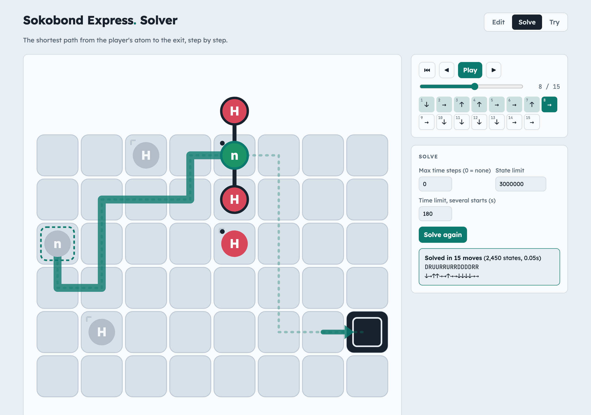
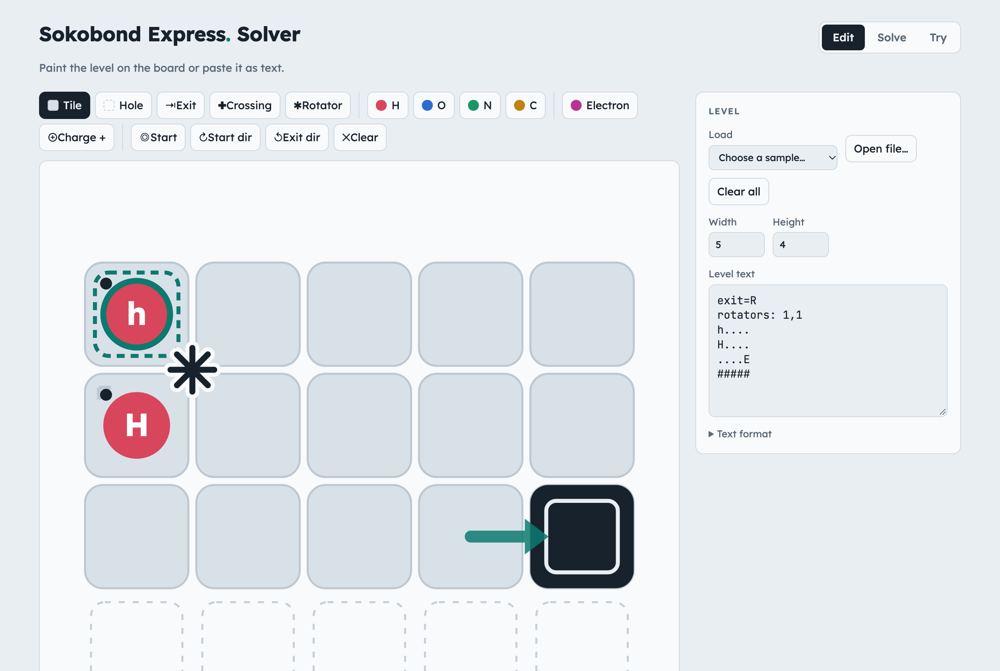
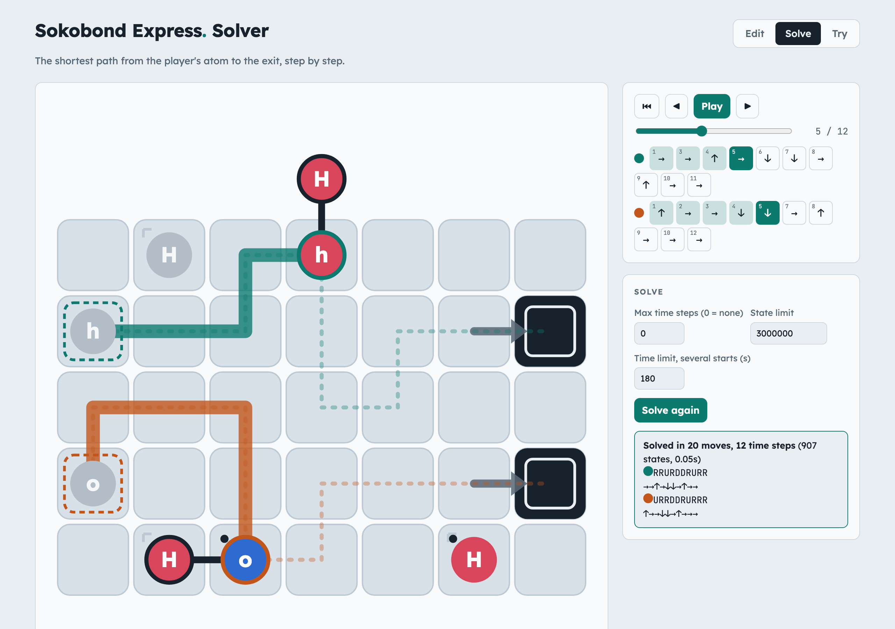
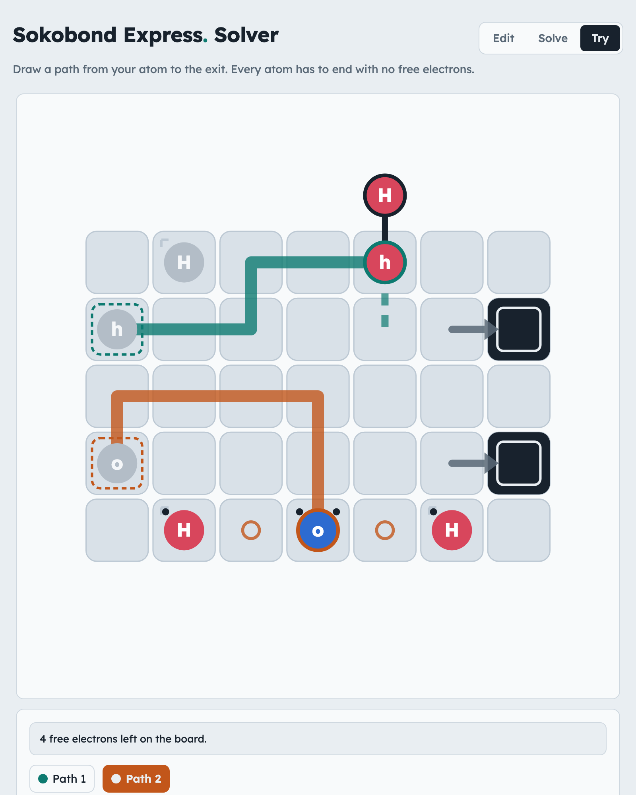

# Sokobond Express solver

A level editor, solver and player for **Sokobond Express** puzzles, in a
single web page.

**Try it online:** https://claude.ai/artifact/Q5JArE2514RUWMDCxqH4wi

Nothing to install. You can also open [`web/index.html`](web/index.html)
in any browser and it works offline.



> [!NOTE]
> I used Claude to write this program. The web page, `CLAUDE.md`, `gamerule.md` and `README.md`,
> except this notice, were written by Claude using Opus 5.5.
> `levels/water.txt` is AI generated test level, and files in `levels/official/` are some of original game levels.
> screenshots in `docs/` were created by AI with browser tool.

## What it does

- **Edit:** paint a level on the board or paste it as text.
- **Solve:** find the shortest solution and play it back step by step.
- **Try:** draw your own paths and see what happens.

### Edit

Pick a tool and click or drag on the board: tiles, holes, exits,
crossings, rotators, atoms (H, O, N, C), electrons, charges and starts.
The level text on the right updates as you paint, and you can paste or
type a level there instead. "Choose a sample…" loads a few small levels,
and "Open file…" loads a level saved as text.



### Solve

The solver searches every move and shows the solution with the fewest
moves (or, with several starts, the fewest time steps). Use Play, the
arrows or the slider to step through it; each move is listed with the
time step it happens in.

Levels with several starts show one coloured path per start:



For large levels with several starts, a full search can run out of time
or memory. The solver then plans each start on its own and fixes clashes
between the plans. This finds a solution much faster, but it may not be
the fastest one, and the page says so. Set how long it may search with
**Time limit, several starts**. **Stop** keeps the best solution found so
far.

### Try

Draw a path from each start with the arrow keys (or WASD), by clicking
a neighbouring tile, or by dragging. The board shows every molecule at the
current time step. When two molecules would collide, the page tells you
where and when, and draws the rest of each path dashed. Click a start, or
the Path buttons, to switch paths. Step back onto the previous tile to
undo.



## Level text format

One row of text per row of cells:

| Text | Meaning |
|---|---|
| `.` | tile |
| `#` or space | hole |
| `E` | exit |
| `+` | crossing |
| `-` | electron |
| `H` `O` `N` `C` | loose atom |
| `h` `o` `n` `c` | start (your atom) |

Use brackets when a cell holds more than one thing:

- `[O+]` is an ion (one `+` per charge);
- `[--]` is two electrons;
- `[H#]` is an atom on a hole;
- `[oE]` is a start on an exit (a loop);
- `[o>]` sets a start's direction, and `[E^]` an exit's (`^ v < >`).

Lines before the grid set defaults and extras:

- `start=R` and `exit=D` set the direction of every start and exit;
- `valence: X=2` sets an element's valence;
- `rotators: 1,1 2,3` places rotators on grid corners (row,column;
  `0,0` is the top-left corner of the grid).

Example (water):

```
start=R
exit=R
..H..
o...E
..H..
```

## Game rules

[`gamerule.md`](gamerule.md) describes the rules the solver follows:
movement, bonding, electrons and ions, crossings, loops, rotators, and how
several starts move together. The rules were worked out by playing the
game, so if the solver disagrees with the game, please open an issue with
the level and the moves.

## Repository

- `web/index.html`: the whole app (engine, solver and interface), no build
  step.
- `gamerule.md`: the game rules.
- `levels/`: example levels as text.
- `docs/`: screenshots for this README.
- `CLAUDE.md`: notes for developers on how the engine and solver work.

Sokobond Express is a game by Draknek & Friends. This is an unofficial
fan-made tool.
